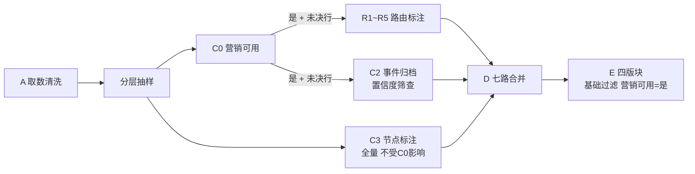

# topic6 数据筛选规则

> 依据当前代码整理。路径均相对 `ma-resources/skills/`。规则冲突时以代码 / 统计脚本 docstring 为准。

整体分 5 层：取数清洗 → 分层抽样 → C0 营销可用闸门 → C2 事件归属置信度 → Phase E 各版块过滤。

---

## 1. 取数清洗（Phase A）

代码：`topic6-fetch-normalize/scripts/fetch_hot_topics.py`

| 规则 | 说明 | 位置 |
|---|---|---|
| 平台 | 只保留抖音 / B站 / 微博 / 知乎 | :41-47、:189-190 |
| 时间 | 只取最近一个完整 ISO 自然周（7 天都有数据）；没有完整周则报错退出 | :157-181 |
| 去重 | `title + platform` 相同时只留 `hot_index` 最高的一条；同时记录出现天数 `_trend_days` | :203-215 |
| 硬校验 | 四个平台都要有数据，去重后至少 200 行，否则退出 | :226-237 |
| 软校验 | 必填字段空值率或 `hot_index≤0` 占比 > 5% 只告警（写入 HC1 issues） | :53 |
| 故障判定 | 必填字段空值率 ≥ 99% 判为数据源故障，exit 1 | :54 |

必填字段：`row_id, platform, title, hot_index, hotpost_time`。

## 2. 分层抽样

代码：`topic6-fetch-normalize/scripts/sample_500.py`

| 模式 | 抽样量 |
|---|---|
| full | 500 |
| demo | 50 |
| skip_sampling | 不抽样，走全量 |

- 按各平台行数占比分配名额（最大余数法），`seed=42`，结果可复现。
- 某平台不够数时，差额从行数最多的平台补。
- 总量不足时直接取全量。

## 3. C0「是否营销可用」：全链路总闸门

判据说明：`topic6-annotation/ks/02_营销可用判定.md`；判据原文：C0 Prompt v13。

### 3.1 判定方式：反向排除

以下一条都不命中才算可用：

| 不可用类型 | 边界说明 |
|---|---|
| 纯时政 | 含宏观财经、央行讲话，即使命中金融行业白名单也不可用 |
| 纯灾难 | — |
| 纯便民 | — |
| 纯赛事数据 | 单纯比分 / 战绩播报 |
| 纯个人纠纷 / 消费投诉 | 单一个案，无规模化 |
| 信息不足 / 泛 UGC | 须同时满足：无具名实体 + 行业归属为空 |
| 纯娱乐八卦 | 无剧名 / 角色名锚点才算 |
| 其他：{原因} | 兜底，必须写明原因 |

**可执行性复核**：把判断说明读给营销 / 公关从业者，对方说不出下一步具体做什么，就回退判否。

参考可用占比约 **37~41%**（DeepSeek-V4-Flash + v13），明显偏离时需人工复核。

### 3.2 脚本切子集

代码：`topic6-annotation/scripts/c0_filter_usable.py:61-87`

| 行类型 | 处理 |
|---|---|
| 是否营销可用 = 是 | 保留 |
| C0 解析失败 / 缺失（未决行，已经过 3 轮重提） | 保留，字段留空，交 HC1 人工判定 |
| 是否营销可用 = 否 | 排除 |

- 熔断：未决行占比 > 5% 报错；保留 0 行也报错。
- 子集只送给 R1~R5 和 C2。
- **C3 节点标注跑全量，不受这一步影响。**
- Phase E 统计只取「是」，未决行不会进入报告。

## 4. C2 事件归属置信度

代码：`topic6-event-registry/scripts/x2_confidence_filter.py:214-217`

| 置信度 | 处理 |
|---|---|
| < 50（`--cut`） | 从事件里摘出，改成单条热点（记录不丢） |
| 50 ~ 74 | 边界带：默认出待裁定表给人工；也可 `--verdict` 交强模型裁定 |
| ≥ 75（`--keep`） | 直接保留 |

阈值依据：抽样 88 条人工判定，单一阈值都有明显误伤；50 以下零误伤，75 以上全部正确。

## 5. Phase E 各版块过滤

口径权威：`topic6-insight/01_统计/e*.py` 的 docstring；摘要见 `topic6-annotation/ks/05_四版块统计口径.md`。

**基础过滤：E1 / E3 / E4 用「是否营销可用 = 是」；E2 上周节点回顾用全量宽表，不过滤营销可用**（`run_stats.py:159-161`，客户 2026-10-30 决策：W43 霜降只出现在 1 条非营销可用热点里，按营销可用过滤会被判成「上周无节点」）。

### E1 行业及热门话题

代码：`topic6-insight/01_统计/e1_industry.py::prep_e1_industry()`；Prompt：`02_洞察/E1_行业话题/v3.md`

| 项 | 规则 | 位置 |
|---|---|---|
| 输入 | 营销可用 = 是 | `run_stats.py:124` |
| 行业拆分 | 「行业归属」按 `\|` 拆开，一条热搜可计入多个行业 | `e1_industry.py:116-118` |
| 热点总计 | 拆开后逐条计数，不去重 | :122 |
| 热度值 | 该行业所有热搜「标准化热度分」的**中位数**，裸数字 | :123 |
| 行业排序 | 按热点总计降序取 TOP10 | :138-143 |
| 主要驱动话题 | 该行业下按「事件簇名」出现次数取前 3（`value_counts().head(3)`），**不看热度值** | :125-129 |
| 展示 | Prompt 去掉「(N次)」，改成列表；不足 3 个有几个写几个 | `v3.md:67-69` |

> 业务反馈「应展示热点数量最多的三个事件，而不是随机展示」的分析见文末「附录：E1 主要驱动话题业务反馈分析」。

### E2 营销节点

前提：全量宽表（不过滤营销可用）中「提取节点」非空，再用节点日历复核真实日期。`dist = 节点日期 - 发布日`：

| dist | 去向 |
|---|---|
| -7 ≤ dist ≤ -1，或日历查不到锚点 | 上周节点回顾 |
| 0 ≤ dist ≤ 30 | 本周节点预告的「补充信号」（文字，不出表格） |
| dist < -7 或 dist > 30 | 不展示 |

「提取节点」本身来自 C3 后处理：只保留「是否节日营销 = 是」且「是否窗口期内 = 是」的节点（`merge_annotations.py:107-117`）。窗口默认取节点定义表的 window_before / window_after，大众节日覆盖为前 30 / 后 7 天，高考覆盖为前 14 / 后 90 天（`datahub_annotate.py:110-111`）。

本周节点预告的表格来自节点日历（发布日 ~ +6 天），与宽表无关。

### E3 平台新鲜事（按平台独立）

| 子版块 | 筛选条件 |
|---|---|
| 热点事件 TOP5 | 事件簇内热搜 ≥ 2 条才进候选；按热点总计、最高标准化分降序 |
| 平台热点词 TOP3 | 驱动词词频 > 1 才算；候选 < 2 个则不出此子版块；按综合热度指数排序 |

平台热点词另有 LLM 打标：剔除主体不明的词，「可借势」加分。打标失败时本轮不展示平台热点词。

### E4 营销发现

| 子版块 | 字段条件 | 候选数 | 打标过滤 |
|---|---|---|---|
| 合作动态 | 是否商业合作 = 是 | TOP20 | 对营销人参考价值 = 有用 |
| 舆情风险 | 是否风险预警 = 是（按事件簇聚合） | TOP20 | 乙方公关可接性 = 接 |
| 营销观察 | 是否营销发现 = 是 | TOP15 | 无（LLM 撰写时挑 3~5 个，最多 8 个） |
| 消费洞察 | 是否消费者行为 = 是 | TOP20 | 无 |

- 候选均按事件簇名去重，按条目标准化分降序。
- 打标漏掉的单条保守保留；打标步骤整体失败时退回全量、不过滤。
- 最后跨版块仲裁：同一事件只保留一处，同池内重复合并链接。

---

## 附录：E1 主要驱动话题业务反馈分析

### 业务反馈

> 行业及热门话题这里应该是每个行业热点数量最多的三个事件，不是随机展示热度值最高的 3 个话题。

### 结论

代码规则和业务要求一致：已经是按热点数量取前 3，没有按热度值排序。问题在于**出现次数相同时没有第二排序条件**，所以看起来像随机。

### 根因

| # | 原因 | 证据 |
|---|---|---|
| 1 | 次数相同时没有第二排序条件。`value_counts().head(3)` 在次数相同时的顺序不确定，与热度无关 | `e1_industry.py:128`。本地 pandas 2.3.3 验证：30 个都只出现 1 次的事件，取前 3 得到 `e0, e1, e28`，没有规律 |
| 2 | 次数相同的情况很常见。C2 会把只有一条热搜的标题自成一个事件，一个行业里多条记录的事件不足 3 个时，剩下的位置从一堆只出现 1 次的事件里任意取 | `topic6-event-registry/scripts/x4_detail_table.py:118-119`（状态「独立热点」/「剔除后独立」） |
| 3 | 业务看不到排名依据。统计层输出带「(N次)」，Prompt 要求去掉次数 | `02_洞察/E1_行业话题/v3.md:67` |

### 修复方案（待确认，尚未改代码）

| 方案 | 内容 | 改动位置 | 建议 |
|---|---|---|---|
| A | 排序改成先按热点数降序，次数相同再按簇内最高标准化热度分降序，最后按事件名，保证结果可复现 | `e1_industry.py:125-129` | 必改 |
| B | 与 E3 一致，只有热搜 ≥ 2 条的事件才进候选，不拿单条热点凑满 3 个，有几个写几个。Prompt 已允许不足 3 个，不用改 | `e1_industry.py:125-129` | 建议 |
| C | 表格保留「(N次)」，业务能直接看到排名依据 | `e1_industry.py` + `v3.md:67`（列定义） | 可选 |

### 真实数据验证（W43）

已用客户 bundle 中的 W43 产物验证（见附录二），**确认是次数相同导致**：
- `06_洞察/v3/e1_data.md`：食品零食的 3 个驱动话题均为「(1次)」，最终报告 `e1_v3.md:15` 展示为「贾冰揭秘田嘉瑞版红烧排骨 / 蛋仔妙脆角头饰上线 / 美味的沉浸式吃播又来嘉宾咯！」——从 20 个只出现 1 次的事件里任取 3 个。
- TOP10 行业中 3 个第三名有并列：科技/AI产业（第 3 名 3 次，5 个并列）、食品零食（1 次，20 个并列）、医疗健康（2 次，3 个并列）。
- 打乱宽表行序重跑 3 次，科技/AI产业、食品零食、医疗健康、数码3C 的驱动话题都会变化。

### 改动后需同步

- 本文档 E1 小节
- `topic6-annotation/ks/05_四版块统计口径.md` E1 小节
- 若采用 C：`02_洞察/E1_行业话题/v3.md` 列定义与禁止项

---

## 附录二：与客户版本（topic6_bundle_20261030）对比

对比对象：`/Users/yuxin/work/feishu/ada_topics/ada_topic6_v2/topic6_bundle_20261030/Topic6 热点报告/agent/skill`（下称「客户版」）。
验证数据：同一 bundle 中的 W43 真实产物 `Projects/W43热点周报_20261019-20261025/05_标注宽表/wide_table_full_r1.xlsx`（3771 行，营销可用 1415 行），用 MA 版统计函数重跑。

### 1. 规则一致性总览

| 层 | 文件 | 结论 |
|---|---|---|
| A 取数清洗 | `fetch_and_clean.py` ↔ `fetch_hot_topics.py` | 一致（平台、完整 ISO 周、title+platform 去重、MIN_ROWS=200）。MA 额外加了空值率软 / 硬校验 |
| B 标准化 | `normalize.py` ↔ `log1p_p1p99_normalize.py` | 公式一致。MA 额外校验各平台最高分 > 90 |
| 抽样 | `sample_500.py` | 一致（最大余数法、seed=42、差额补给最大平台） |
| C0 筛选 | `c0_filter_usable.py` | 筛选口径一致（「是」+ 未决行保留，> 5% 熔断）。MA 去掉了 `--force-accept-unresolved` 人工放行，改由协调器补标注 |
| C3 时效窗口 | `c3_v6_timewindow.py` ↔ `datahub_annotate.py::_c3_timewindow` | 一致（大众节日 30/7、高考 14/90，节点定义表相同） |
| D 合并 | `merge_annotations.py` | 「提取节点」过滤规则一致。MA 在 smoke/demo 模式下过滤后全空时回退原值（full 不受影响） |
| 标注 Prompt | C0 v13、R1~R5、C3 v7 | 全部逐字相同 |
| 洞察 Prompt | E1 v3、E2 v7、E3 v6 + 打标 / 初稿、E4 各子 Prompt | 全部逐字相同 |
| E1 / E3 / E4 统计 | `01_统计/e1/e3/e4*.py`、`_common.py` | 逻辑一致，只差链接标题转义（MA 新增 `md_link_title`，修 W44 方括号 / 换行问题） |
| E2 统计 | `01_统计/e2_nodes.py` | **日历来源不同，见下方问题 1** |
| E4 编排 | `pipeline_e4_agent_steps.py` ↔ `pipeline_e.py` | 打标过滤、合作动态组优先级、舆情风险组内 / 组间排序、`_RISK_FULL_ANALYSIS_LIMIT` 一致 |

客户版中、MA 版没有的内容均不构成缺失：
- `E4_营销发现/v13.md`：客户已停用（SKILL.md:199）。
- `_audit_coop_risk` / `_audit_marketing_consumer`：客户也未接入流程（`phases/E_insights.md:259`）。
- 内容标注 v1~v9、节点标注 v1~v6：历史版本。

### 2. 规则缺失 / 偏差

#### 问题 1（中，2026-11-10 已修复）：E2 节点日历与客户版不一致

> 已修复：`marketing_calendar_2026.csv` 补齐 4 个电商节点并修正 3 个大促类型，节点集合与类型与客户 `2026年营销节点_byday.md` 一致（223 个），见 `TOPIC6_CHANGELOG.md` 2026-11-10。以下为修复前记录。

| 项 | 客户版 | MA 版 |
|---|---|---|
| 日历文件 | `references/2026年营销节点_byday.md`（223 个节点） | `topic6-fetch-normalize/references/marketing_calendar_2026.csv`（219 个节点） |
| 位置 | `e2_nodes.py` 默认路径 | `e2_nodes.py:21-27` |

差异：
- MA 缺 4 个电商节点：**年货节、618预售启动、99大促、双11预售启动**。
- 3 个节点类型不同：双11大促 / 双12大促 / 618大促，客户为「电商大促」，MA CSV 为「大众节日」。

影响：
- C3 用的节点定义表（`nodes_definition.csv:220-223`）**有**这 4 个节点，所以 C3 能提取出「双11预售启动」；但 E2 在 MA 日历里查不到锚点，会走「查不到锚点 → 保守归入上周 + 标注（锚点未核实）」分支。当前正处于双11预售期，影响直接。
- 本周节点预告表格的「节点类型」列对双11 / 双12 / 618 显示错误。两种类型都属于长筹备节点，密度摘要不受影响。

建议：E2 改为读客户的 `.md` 日历，或用 `generate_marketing_calendar.py` 基于 `nodes_definition*.csv` 重新生成 CSV。确保 E2 和 C3 用同一份节点定义。

#### 问题 2（低）：客户版有、MA 版无的人工放行开关

C0 未决行 > 5% 时，客户版可以用 `--force-accept-unresolved --reason` 人工放行并记录审计日志，MA 版直接报错。这是 MA 有意的改动（由协调器补标注），口径不变，记录在此备查。

### 3. 类似「并列无次序」问题扫描

E1 的问题本质是：**排序键出现并列时没有第二排序条件，或结果依赖宽表行序**。客户版与 MA 版代码一致，两边都有这个问题。按同一模式扫描全部统计脚本，并用 W43 数据打乱行序（5 个随机种子）实测：

| # | 位置 | 问题 | W43 实测 | 严重度 |
|---|---|---|---|---|
| 1 | E1 主要驱动话题 `e1_industry.py:128` | 只按次数排序，并列时任取 | TOP10 中 3 个行业第三名并列；打乱行序后 4 个行业结果变化 | **高（业务已反馈）** |
| 2 | E4 候选池 `e4_marketing.py:49/77/85` | 只按单条标准化分排序后取 TOP N。分数在 100 封顶，并列很多（营销可用中 72 条 = 100 分） | 消费洞察：5 次中 4 次入池集合变化（「金饰金价暴跌」与「电视剧《小城良方》」互换）；合作动态：1 次入池集合变化（「成马极氪休息区」与「VCTCN 八支队伍官宣」互换）；营销观察：集合不变、顺序变化 | **中** |
| 3 | E3 TOP5 事件「行业」列 `e3_platforms.py:223` | 取簇内**第一条非空**行业归属，不是众数，结果依赖行序 | 微博「肖战巡回演唱会举办」显示「数码3C\|音乐」（众数是「音乐」，25 条）；知乎「令人心动的offer8」显示三行业组合（众数「影视综艺」） | **中** |
| 4 | E1 行业 TOP10 `e1_industry.py:140` | 只按热点总计排序，第 10 / 11 名并列时任取 | W43 无并列（第 10 名 39，第 11 名 34） | 低（潜在） |
| 5 | E4 代表热搜 `e4_marketing.py:49` | 簇内最高分并列时代表标题任取（`drop_duplicates keep=first`） | 合作动态 1 个簇 | 低 |
| 6 | E3 TOP5 排序 `e3_platforms.py:242` | 已有第二排序条件（热点总计 → 最高分） | 打乱行序后 4 个平台结果都不变 | 无问题 |
| 7 | E3 平台热点词 `e3_platforms.py:132/183` | 综合热度指数为连续值 | 4 个平台第 3 名无并列 | 无问题 |
| 8 | E4 舆情风险 `e4_marketing.py:62-65`、E4 编排排序 | groupby 按事件名有序 + Python 稳定排序 | 结果可复现；13 个簇代表分 = 100，按事件名字典序决定入池，不按业务含义 | 低 |

### 4. 建议修复（待确认，尚未改代码）

统一原则：**所有 TOP N 截断都要有完整、确定的排序键，最后一级用事件名兜底，保证同一份宽表多次运行结果相同**。

| 问题 | 修复 | 位置 |
|---|---|---|
| 1 | 见附录「E1 主要驱动话题业务反馈分析」方案 A / B / C | `e1_industry.py:125-129` |
| 2 | 排序键改为（标准化分降序，事件簇热搜条数降序，事件簇名升序）。分数封顶并列时，规模更大的事件优先 | `e4_marketing.py:49/77/85` |
| 3 | 「行业」列改为簇内行业归属拆分后的众数（并列时取簇内最高分那条的行业） | `e3_platforms.py:223` |
| 4 | 行业 TOP10 加第二排序键：热度值中位数降序，再按行业名升序 | `e1_industry.py:140` |
| 5 | 代表行选择加第二排序键（发布时间或标题） | `e4_marketing.py:49/77/85` |
| E2 日历 | 见问题 1 | `e2_nodes.py:21-27` |

改动后需同步：本文档、`topic6-annotation/ks/05_四版块统计口径.md`；用 W43 宽表回归，确认 5 次打乱行序结果一致。
