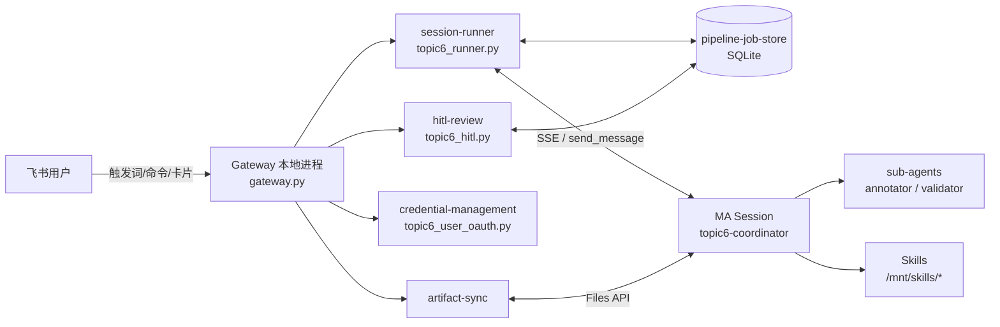

# Topic6 · Project Context

## Purpose
Topic6「社媒热点周刊」是运行在火山方舟 Managed Agents（MA）上的飞书 Bot 场景：用户在飞书发送触发词 → Gateway 创建 MA Session → Coordinator 编排四平台热点取数、标准化、DataHub 多路标注、C2 事件归档、合并宽表、E1~E4 洞察、飞书文档发布、网页生成与妙搭发布，中间穿插 HC1/HC2/HC3 人工审核。

## 两层架构



| 层 | 运行位置 | 代码 | capability |
|---|---|---|---|
| Gateway 接入层 | 本地主机 Python 进程 | `gateway.py` `config.py` `topic6_runner.py` `pipeline_store.py` `topic6_hitl.py` `topic6_progress_card.py` `job_notifier.py` `feishu_doc_publisher.py` `artifact_sync.py` `topic6_user_oauth.py` `authorize_miaoda_user.py` | gateway-command-routing、session-runner、pipeline-job-store、hitl-review、credential-management、artifact-sync |
| MA Agent 层 | 方舟沙箱 | `ma-resources/agents/*.json|*.system.md` | coordinator-orchestration、sub-agents |
| MA Skill 层 | 方舟沙箱 `/mnt/skills/` | `ma-resources/skills/*` | skill-fetch-normalize、skill-annotation、skill-event-registry、skill-insight、skill-web-publish（validator Skill 并入 sub-agents） |
| 部署与测试 | 本地 | `update_ma.sh` `tools/*` `ma-resources/create_all.sh` `environment.json` `memory*` `run_tests.sh` `../../tests/test_topic6_*.py` | ma-resource-deployment、testing-and-verification |

## 代码地图（改什么 → 先读哪个 spec）

| 想改的东西 | spec | 主要文件 |
|---|---|---|
| 新命令、触发词、模式、配置项 | gateway-command-routing | `gateway.py` `config.py` `env.example` `topic6_runner.parse_trigger` |
| idle/nudge/HC 识别/重连/恢复/最终链接 | session-runner | `topic6_runner.py` |
| 表结构、状态机、查询 | pipeline-job-store | `pipeline_store.py` |
| 审核卡片、按钮、回读在线表格、通知 | hitl-review | `topic6_hitl.py` `feishu_doc_publisher.py` `topic6_progress_card.py` `job_notifier.py` |
| Bot/用户 token、Vault | credential-management | `gateway.py`(refresher) `topic6_user_oauth.py` `../../arkagent/lark_vault.py` |
| 产物本地同步 | artifact-sync | `artifact_sync.py` |
| 流水线步骤、HC JSON、阶段标记、禁止项 | coordinator-orchestration | `ma-resources/agents/coordinator.system.md` `coordinator.json` |
| 子 Agent 输入/输出 | sub-agents | `ma-resources/agents/{annotator,validator,insighter}.*` `skills/validator/` |
| 取数/标准化/抽样 | skill-fetch-normalize | `skills/topic6-fetch-normalize/scripts/*` |
| 初始化、run_config、发布产物、DataHub、合并、成本 | skill-annotation | `skills/topic6-annotation/scripts/*` `prompts/` |
| C2 事件归档 | skill-event-registry | `skills/topic6-event-registry/scripts/run_topic6_c2.py` 等 |
| E1~E4、报告合并、自校验、飞书文档 | skill-insight | `skills/topic6-insight/scripts/*` `01_统计/` `02_洞察/` |
| 网页与妙搭 | skill-web-publish | `skills/topic6-web-report/` `skills/miaoda-web-publish/` |
| 打包、上传、建 Agent、环境变量 | ma-resource-deployment | `update_ma.sh` `tools/pack_skills.sh` `tools/upload_skills.py` `ma-resources/create_all.sh` `environment.json` |
| 测试与排查 | testing-and-verification | `../../tests/test_topic6_*.py` `run_tests.sh` `tools/session_triage.py` |

## 跨层关键契约（改一处必须查另一处）

| 契约 | 生产方 | 消费方 |
|---|---|---|
| 首条消息格式 `[topic6] 触发词=热点报告 mode=… workspace_root=…` | session-runner | coordinator-orchestration |
| `[project_dir] /workspace/Projects/<dir>` | coordinator | session-runner `extract_project_dir` |
| `[phase] X` | coordinator R10 | session-runner `_maybe_update_phase`、idle 判定 |
| `[need_decision]` | coordinator R15 | session-runner idle 判定 |
| HC1/HC2/HC3 JSON schema | coordinator | session-runner `validate_hc_payload`、hitl-review 卡片 |
| `HCx pass|reject: …|remark: …` + `/mnt/session/uploads/hc_edits/…` | hitl-review | coordinator HC 决策处理 |
| `{"phase":"H","release_status":"finished","online_url":…}` | coordinator Phase H | session-runner `extract_final_online_url` |
| `outputs/<project>/manifest.json` | skill-annotation `publish_node_artifacts.py` | artifact-sync 物化、hitl-review 宽表上传 |
| `wide_table_{mode}_r{N}.xlsx` 命名 | skill-annotation `merge_annotations.py` | coordinator、session-runner 兜底、hitl-review |
| Vault 凭据名 `LARKSUITE_CLI_TENANT_ACCESS_TOKEN` / `LARKSUITE_CLI_USER_ACCESS_TOKEN` | credential-management | skill-insight 发布、skill-web-publish 妙搭 |
| `run_config.yaml` `status.*` 块 | 各 Skill 脚本 | coordinator 恢复、pipeline_e HC2 门禁 |

## Tech Stack
- Gateway：Python 3.11（conda env `topic6`）、asyncio、SQLite(WAL)、httpx、lark_oapi（经 `arkagent.feishu`）、方舟 MA API（经 `arkagent.ark`）。
- 沙箱：Python + pandas/openpyxl/numpy/openai/httpx/pyyaml、Node（网页构建 `.mjs`）、lark-cli v1.0.95。
- 外部服务：方舟 MA / Files / Vault / Memory Store、hot-topics MCP、DataHub、飞书 Open API、妙搭。
- 模型：统一走 bmc-llm-relay（blueai 模型网关）。Agent `DeepSeek-V4-Flash-0731`（BYOK，Gateway 附加 `X-User-Model-Header-*`）；C2/E/demo `Doubao-Seed-Evolving`；Embedding `Doubao-embedding`（沙箱脚本只读 `LLM_RELAY_*`）；DataHub `DeepSeek-V4-Flash`（DataHub 侧调度，不经方舟）。`ARK_*` 只用于 Managed Agent 控制面。

## Conventions
- `ma-resources/` 是唯一部署源码目录；`tools/out/`、`skill_ids.json`、`created_ids.json` 是生成物。
- 能脚本化的确定性逻辑必须脚本化，Prompt 只负责编排与判断（"能程序跑就不让模型跑"）。
- Prompt 只增不改：新建 `v{N+1}.md`，同步 SKILL.md / `_版本状态.md` / `version_mapping.md`。
- 沙箱内禁止打印凭证；短期 token 只经 Vault 注入。
- 每个行为变更：openspec change → 代码 → `run_tests.sh` → `update_ma.sh` → 重启 Gateway → smoke/demo 端到端 → `openspec archive` → CHANGELOG。

## 开发工作流

```bash
cd scenarios/feishu-bot/cases/topic6
openspec list --specs                       # 看有哪些 capability
openspec show <capability> --type spec      # 只读要改的那份 spec，而不是全部源码
openspec new change <change-id>             # 起变更（或手动建 openspec/changes/<id>/）
#   proposal.md / design.md(跨层时必写) / tasks.md / specs/<capability>/spec.md(ADDED|MODIFIED|REMOVED)
openspec validate <change-id> --strict --no-interactive
#   实施 → ./run_tests.sh → ./update_ma.sh → 重启 Gateway → 飞书「热点周报 smoke」
openspec archive <change-id> --yes          # 把 delta 合并回 openspec/specs/
```

## 已知待修正（基线盘点时发现，未在本次修改代码）
- `ma-resources/agents/insighter.system.md` 引用了不存在的 `01_统计/e2_marketing_node.py`、`e3_platform.py`（实际 `e2_nodes.py`、`e3_platforms.py`）；当前主流程不委派 insighter，影响有限。
- `prompts/运行前置.md` 仍是客户原版（提到 `ANTHROPIC_API_KEY`、`authorized_users.json` 等），以 coordinator-orchestration 与 ma-resource-deployment 为准。
- `skills/topic6-fetch-normalize/SKILL.md` 示例带 `--start/--end`，与 Coordinator 契约（不传）不一致，仅作手工调试示例。
- `topic6-insight/scripts/pipeline_e.py` 按文件名字符串排序选 Prompt 最新版，引入 `v10.md` 前需改为数值排序。
