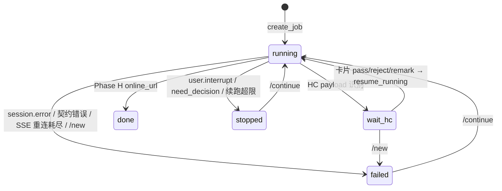

# pipeline-job-store Specification

## Purpose
本地持久化 Topic6 长任务：飞书会话键 `(chat_id, thread_id, user_open_id)` ↔ 方舟 MA Session 的映射、任务状态机、HC 审核事件和用户 OAuth 凭据元数据。

源码：`pipeline_store.py`（`PipelineStore` / `PipelineJob` / `HcEvent`）。

## Requirements

### Requirement: SQLite 存储位置与连接
系统 SHALL 使用独立 SQLite 文件存储 pipeline 状态，路径优先级为构造参数 `db_path` > 环境变量 `TOPIC6_PIPELINE_DB_PATH` > 默认 `<repo>/data/topic6_pipeline.db`（`Path(__file__).parents[3]/data`）。连接 MUST 使用 `check_same_thread=False`、`isolation_level=None`、`PRAGMA journal_mode=WAL`、`PRAGMA foreign_keys=ON`，所有读写 MUST 持有实例级 `threading.Lock`。数据库文件及 `-wal`/`-shm` 存在时 MUST `chmod 0o600`。

#### Scenario: 未配置路径
- **WHEN** 未传 `db_path` 且 `TOPIC6_PIPELINE_DB_PATH` 为空
- **THEN** 使用 `<repo>/data/topic6_pipeline.db`，父目录不存在时自动创建

#### Scenario: 文件权限
- **WHEN** `PipelineStore` 初始化完成
- **THEN** 数据库主文件及已存在的 `-wal`、`-shm` 权限为 `0600`

### Requirement: 表结构与向后兼容迁移
系统 SHALL 维护三张表：`pipeline_jobs`、`pipeline_hc_events`、`user_oauth`，建表 MUST 幂等（`CREATE TABLE IF NOT EXISTS`）。后加列 MUST 通过 `PRAGMA table_info` 检测缺失后 `ALTER TABLE ADD COLUMN ... NOT NULL DEFAULT ...` 补齐，不得要求删库。

| 表 | 列（关键） |
|---|---|
| `pipeline_jobs` | `job_id` PK、`chat_id`、`thread_id`（默认 `''`）、`user_open_id`、`ma_session_id`、`mode`、`project_dir`、`current_phase`（默认 `'A'`）、`status`（默认 `'running'`）、`started_at`、`updated_at`、`finished_at`、`last_error`、`online_url`、`progress_card_message_id`*、`docs_folder_token`* |
| `pipeline_hc_events` | `id` 自增 PK、`job_id` FK（ON DELETE CASCADE）、`hc_kind`、`payload`(JSON)、`card_message_id`、`user_decision`、`user_note`、`operator_label`*、`artifacts`*(JSON，默认 `'{}'`)、`created_at`、`resolved_at` |
| `user_oauth` | `open_id` PK、`vault_id`、`credential_id`、`refresh_token`、`expires_at`、`scopes`（空格分隔）、`updated_at` |

`*` 为迁移补列。索引：`(chat_id, thread_id, user_open_id, status)`、`ma_session_id`、`(job_id, hc_kind)`、`card_message_id`。

#### Scenario: 老库缺列
- **WHEN** 已有数据库的 `pipeline_jobs` 不含 `docs_folder_token`
- **THEN** 初始化时补列且默认值为 `''`，已有行可正常读取

#### Scenario: 新增列
- **WHEN** 开发者为任一表新增列
- **THEN** MUST 同时在建表 SQL 和 `PRAGMA table_info` 补列分支中添加，并带 `NOT NULL DEFAULT` 以保证回滚安全

### Requirement: 任务状态机
`pipeline_jobs.status` SHALL 仅取 `running`、`wait_hc`、`done`、`failed`、`stopped`。`HC_KINDS` SHALL 为 `("HC1","HC2","HC3")`。状态迁移 MUST 只通过下列方法完成：

| 方法 | 新状态 | 副作用 |
|---|---|---|
| `create_job` | `running` | `job_id = job_<uuid hex 前12>`，`current_phase='A'` |
| `mark_wait_hc(kind)` | `wait_hc` | `current_phase = kind` |
| `resume_running(next_phase)` | `running` | 清空 `finished_at`、`last_error` |
| `mark_done(online_url)` | `done` | 写 `finished_at`；`online_url` 为空时保留旧值；清空 `last_error` |
| `mark_failed(error)` | `failed` | 写 `finished_at`、`last_error` |
| `mark_stopped(reason)` | `stopped` | 写 `finished_at`、`last_error=reason`（默认 `user_interrupt`） |

#### Scenario: done 后 /continue
- **WHEN** 任务状态为 `done`
- **THEN** `get_resumable_job_by_session_key` 不返回该任务

#### Scenario: mark_done 不覆盖已有链接
- **WHEN** `mark_done(job_id, online_url="")` 且库中已有 `online_url`
- **THEN** 保留原 `online_url`

### Requirement: 任务查询语义
系统 SHALL 提供以下查询并保持语义稳定：
- `get_active_job()`：全局最新一条 `running|wait_hc`（按 `started_at DESC`），用于"同一 Gateway 只允许一个活跃 Job"。
- `get_active_job_by_session_key(chat, thread, user)`：会话键上最新 `running|wait_hc`，用于 `/new`。
- `get_resumable_job_by_session_key(chat, thread, user)`：会话键上 `updated_at` 最新的 `running|wait_hc|failed|stopped`，用于 `/continue`。
- `list_active_jobs()`：全部 `running|wait_hc`（`started_at ASC`），用于启动恢复。
- `list_jobs(status, limit=50)`、`get_job_by_ma_session(session_id)`。

`thread_id` 为空 MUST 归一为 `''` 后再参与查询。

#### Scenario: 被本地误判失败的任务可续跑
- **WHEN** 任务因 SSE 断线被 `mark_failed`，用户在同一会话发送 `/continue`
- **THEN** `get_resumable_job_by_session_key` 返回该任务

#### Scenario: 跨用户互斥
- **WHEN** 用户 A 有 `running` 任务，用户 B 在另一群触发
- **THEN** `get_active_job()` 返回 A 的任务，B 的启动被拒绝

### Requirement: HC 审核事件
`append_hc_event` MUST 拒绝 `hc_kind ∉ HC_KINDS`（`ValueError`）。`resolve_hc_event(event_id, decision, note, operator_label)` SHALL 写入决策并设置 `resolved_at`。`append_remark` SHALL 只写 `user_note` 不 resolve。`get_pending_hc_by_card(card_message_id)` SHALL 只返回 `resolved_at IS NULL` 的最新事件。`latest_hc_for_job(job_id, kind)` 返回同类最新事件（含已 resolve）。`list_resolved_hc_for_job` 按 `created_at, id` 升序。`set_hc_artifacts` 以 JSON 存 Gateway 发布的飞书产物（token/type/url）。

#### Scenario: 重复点击已处理卡片
- **WHEN** HC 事件已 `resolved_at` 非空，同一卡片再次回调
- **THEN** `get_pending_hc_by_card` 返回 `None`

#### Scenario: 非法 HC 类型
- **WHEN** 调用 `append_hc_event(job_id, "HC4", {})`
- **THEN** 抛出 `ValueError("unknown hc_kind=HC4")`

### Requirement: 用户 OAuth 元数据
`save_user_oauth` SHALL 以 `open_id` 为键 upsert `vault_id/credential_id/refresh_token/expires_at/scopes` 并刷新 `updated_at`。`get_user_oauth` 返回 dict，`scopes` 解析为 tuple。`refresh_token == ""` 表示该用户需要重新授权，刷新协程 MUST 跳过此类用户。Access token 本体 MUST NOT 存入本库（只在方舟 Vault 中）。

#### Scenario: 需重新授权标记
- **WHEN** 用户 refresh 失败被标记为 `refresh_token=""`
- **THEN** `list_user_oauth` 仍返回该用户，但 Gateway 刷新协程跳过它，等待用户下次触发时聊天内扫码
